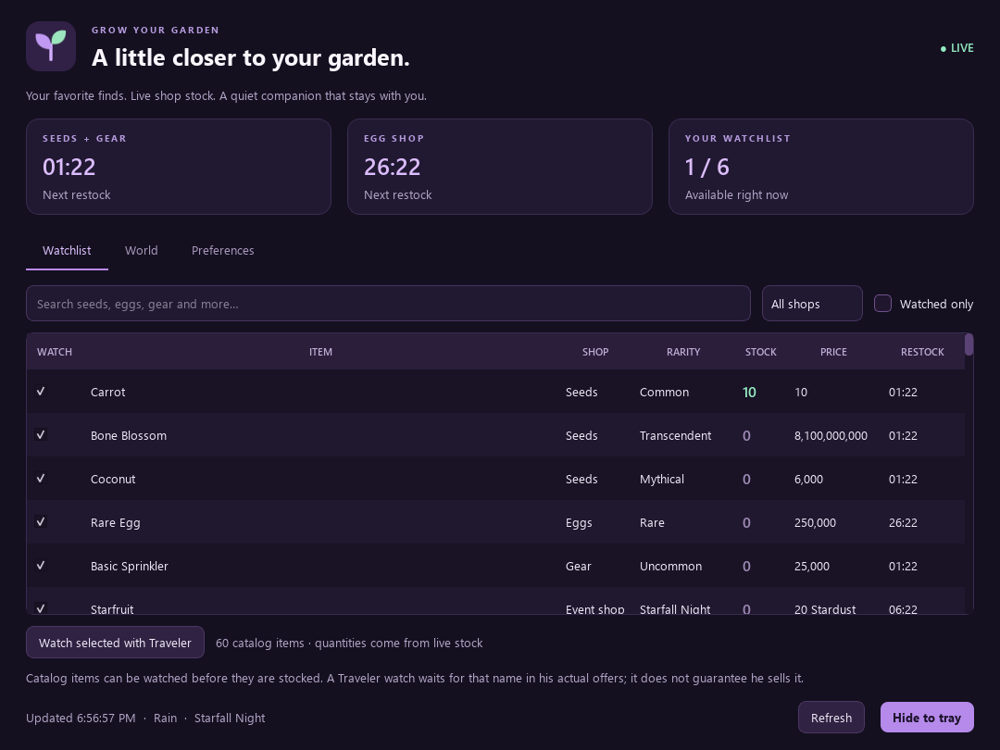
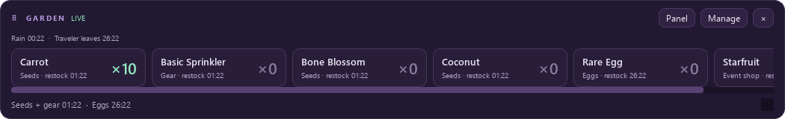
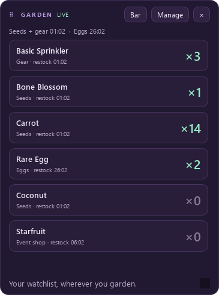
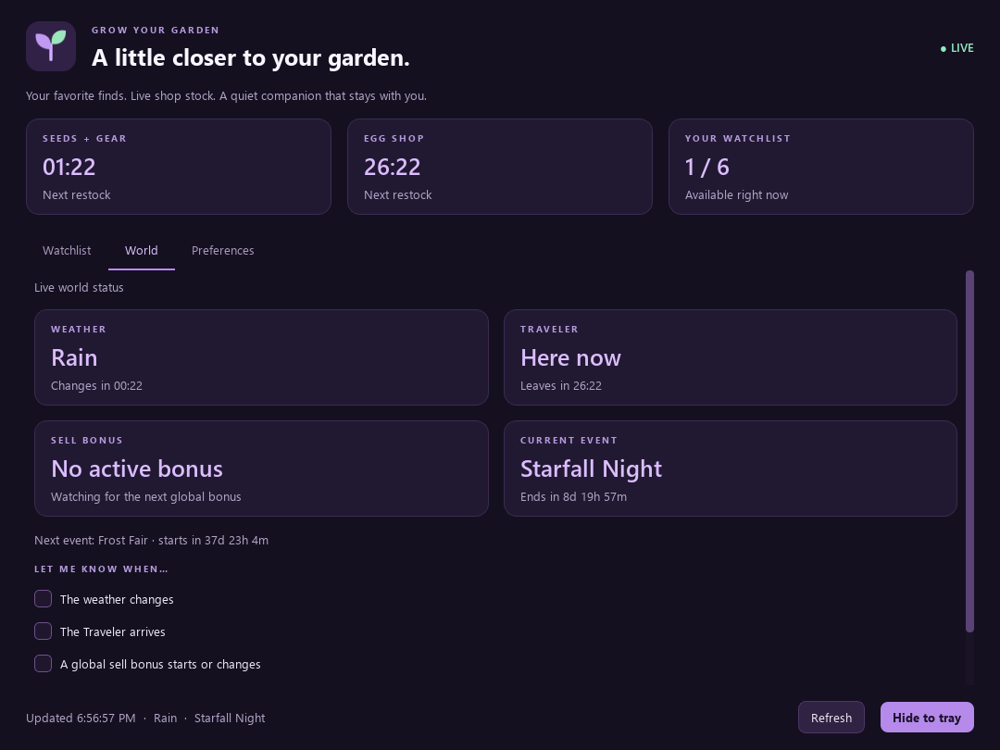

# Grow Your Garden Companion

A dark-purple Windows desktop companion for the GardenChat stock shown at [garden.orpine.app](https://garden.orpine.app/). Runs independently of your browser. Includes a top-screen bar, floating mini-panel, searchable watchlists, live quantities, server-based countdowns and system-tray alerts.

**Windows 10/11 · Python 3.11+ · PyQt6 · GPL-3.0 · Version 1.2.0**

## New in v1.2

- Separate **VR capture bar and panel** for XSOverlay and other window-capture overlays.
- Opaque, titled, resizable windows with the same live watchlist, restock clocks and world status as the desktop views.
- Independent VR visibility and saved positions, with controls in Preferences and the system tray.
- Scrollable Preferences so controls remain accessible on smaller displays.

See [VR setup and troubleshooting](docs/VR.md). This provides Windows capture targets; XSOverlay or another SteamVR overlay app displays them in your headset. In-headset capture has not yet been verified.

## New in v1.1

- Uses the documented public v1 API for live stock and the full item catalog.
- Lets you watch catalog items before their shop is active, including advance Traveler watches by name.
- Adds a **World** tab with weather, Traveler, event and sell-bonus timers.
- Adds optional weather-change, Traveler-arrival and sell-bonus alerts, plus world status in both overlays.

Existing preferences and watches are retained. This repository contains the stock-monitoring companion; the separate local macro experiment is not included.



*Actual app screenshot captured during live-feed verification. The displayed stock is historical, not a current inventory reading.*

## Get started

1. [Download the source ZIP](https://github.com/YvesChasse/Grow-your-garden-companion/archive/refs/heads/main.zip) and extract it.
2. Install Python 3.11 or newer, then double-click **Setup.cmd**.
3. Double-click **Run Companion.cmd**, wait for **LIVE**, and choose your watched items.

To create a standalone Windows app, double-click **Build EXE.cmd**. The executable is generated locally in `dist/`; compiled binaries are not stored in the source repository.

**Updating from v1.0/v1.1:** quit the old companion from its tray menu, replace the application/source files, and run **Setup.cmd** again if using source. Your saved watchlist stays in the same preferences folder. VR windows start off; enable them in **Preferences → VR / XSOverlay**. World alerts are opt-in in **World**.

## Two ways to keep an eye on your garden

**Compact top-screen bar** — a draggable horizontal watchlist with quantities and countdowns. Scroll sideways to see more items.



**Floating mini-panel** — a vertical watchlist with separate item clocks. Toggle between layouts or show both from Preferences.



Both overlays stay above normal desktop windows and remember their positions, sizes and opacity. Their screenshots show captured stock from the same verification session.

## Use it in VR with XSOverlay

1. Open **Preferences → VR / XSOverlay** and enable **Show VR capture bar**, **Show VR capture panel**, or both.
2. In XSOverlay, open **Layout mode**, choose **Add Window**, then select **Garden Companion - VR Bar** or **Garden Companion - VR Panel** as the capture target.
3. Use **Windows Graphics Capture** in XSOverlay's window-capture settings. Position and scale the view in VR, and adjust its opacity there.
4. Keep the captured window open and unminimized. The main watchlist window can be hidden to the tray. Restore a capture window using its tray toggle or Preferences if it was closed.

The VR windows stay on top on the desktop, use solid backgrounds, and keep stable titles. Their content uses your existing watchlist and the same API connection; desktop opacity controls do not change VR capture windows. Desktop alerts remain Windows notifications and are not automatically forwarded into VR.

Other overlay tools with Windows window capture can select these same windows; their setup and compatibility vary. See [the VR guide](docs/VR.md) for recovery steps and testing limits. XSOverlay's official documentation covers [Layout mode / Add Window](https://xsoverlay.vercel.app/gettingstarted) and [capture methods](https://xsoverlay.vercel.app/settings).

## Start the Windows app

If you have the executable, double-click **GrowYourGardenCompanion.exe**. Python is not required for the executable. It is a locally built, unsigned Windows x64 application.

1. Wait for the **LIVE** indicator and check the items you want to watch.
2. Open **Preferences** to show the top-screen bar, floating panel, or both.
3. Drag the **GARDEN** heading to move an overlay. Drag its lower-right corner to resize it.
4. The **Bar / Panel** button switches layouts. **Manage** returns to the watchlist. **×** hides that overlay.
5. Closing the main window keeps the companion in the tray. Right-click the leaf icon to restore windows, refresh, or **Quit**. Windows may place the icon in its hidden-icons area.

The watchlist starts empty so you can choose your own items. The horizontal bar scrolls when your list is wider than the screen. The panel scrolls vertically for longer lists. **Reset overlay positions** recovers windows after a monitor change.

## World timers and alerts

Open **World** to see the current weather, the Traveler's arrival/departure countdown, active sell bonuses, and current/next event timing. Check the alerts you want: **weather changes**, **Traveler arrives**, and **sell bonus starts or changes**. These start off; the first successful update stays quiet. The main **Desktop alerts** switch in Preferences controls all alerts.

Weather, Traveler and active-bonus status can also appear in both overlays. Turn **Show weather, Traveler and bonus status in my overlays** off in World if you prefer a stock-only view.



*Captured during the version 1.1 live integration check; this is not a current reading.*

## Run from source

Requires Windows 10/11 x64, Python 3.11 or newer, and an internet connection. Tested here with Windows 11 x64 and Python 3.12.

1. Install Python from [python.org](https://www.python.org/downloads/windows/) if needed.
2. Extract the full source folder to a writable location.
3. Double-click **Setup.cmd** once; it creates a private `.venv` and installs the pinned dependencies.
4. Double-click **Run Companion.cmd**.

Or from PowerShell in this folder:

```powershell
.\setup.ps1
.\.venv\Scripts\python.exe .\main.py
```

If script execution is restricted, use the `.cmd` launchers; they set the execution policy only for that invocation. They do not modify the machine's policy. Setup also accepts an explicit Python path:

```powershell
.\setup.ps1 -PythonExecutable 'C:\Path\To\python.exe'
```

## Build an executable

Double-click **Build EXE.cmd**, or run:

```powershell
.\build.ps1
```

The script installs the build dependencies, runs the automated tests, generates the leaf icon, and builds `dist\GrowYourGardenCompanion.exe` with PyInstaller. Build on Windows for a Windows executable. The build is a single file; it bundles Python, PyQt6 and the required Qt libraries.

For an existing environment:

```powershell
.\build.ps1 -PythonExecutable 'C:\Path\To\python.exe'
```

`-SkipInstall` skips dependency installation when they are already installed. The build does not sign the executable or install a Windows service.

## Stock, clocks and alerts

- Live stock uses [`GET /api/v1/live`](https://garden.orpine.app/api/v1/live), and the full catalog uses [`GET /api/v1/items`](https://garden.orpine.app/api/v1/items), as documented in the [OpenAPI specification](https://garden.orpine.app/api/v1/openapi.json). See [API verification](docs/FEED.md).
- Seeds, gear, eggs, event-shop items and traveling-merchant offers are supported. Other item kinds, such as decorations, are included when the feed lists them in an event shop or traveler inventory.
- **Full catalog:** choose items before their shop or event is active. Catalog names and rarity are saved locally; prices and quantities only come from live stock. An absent item shows **—**, not a made-up zero. The catalog refreshes at launch and once a day; a catalog failure does not interrupt live stock.
- **Traveler watchlists:** select any item row and click **Watch selected with Traveler** to wait for that name in his actual offers, even before your first visit. The catalog does not identify a Traveler-specific inventory, so this watch is a request, not a promise that he sells the item. Actual offers are also discovered automatically while he is present. Saved names and watches remain after he leaves.
- Items are discovered from real responses. There is no fabricated catalog or bundled stock fallback. Previously seen item names remain selectable after a temporary shop closes; their quantity shows **—**, never a fabricated zero.
- Countdown clocks use the server's `now` value and a monotonic local timer. Seed/gear, egg and event-shop clocks are separate. Traveler clocks show arrival while away and departure while present; they do not promise particular stock.
- The API's stock quantity is the allowance per player for that restock. The companion cannot see your purchases or calculate your personal remaining allowance.
- Refreshes follow `nextChangeAt`, with a small jitter and a five-minute maximum interval, matching the site's approach. Failures retry with a growing delay, capped at one minute; a numeric `Retry-After` can extend that delay up to an hour. Manual refresh is rate-limited.
- **STALE** means quantities are last-known, not confirmed current. Failed requests, invalid responses and a missed update deadline cannot silently become a fresh zero-stock result. There is no offline stock replay on startup.
- The first successful response establishes a quiet baseline. Alerts fire when watched items become available, and optionally on a new restock cycle when they remain available. Duplicate responses do not repeat the same alert. Alerts are grouped into one message per update.
- Notifications use the Windows system tray. Sound is optional. Windows notification preferences and Do Not Disturb affect whether messages appear. Use **Test notification** to check your machine.

The app must be running and the PC awake to monitor stock. It reconnects after interrupted requests; it cannot recover notifications for every missed restock while the computer was asleep. Desktop windows work over normal desktop and borderless windows. VR viewing requires a separate window-capture overlay app such as XSOverlay; the companion does not inject into the game or connect directly to SteamVR.

## Preferences and privacy

Settings are stored at `%LOCALAPPDATA%\GrowYourGardenCompanion\preferences.json`. They include watchlists, remembered item names, desktop and VR window visibility and positions, desktop opacity, alert options and startup-window preference. A small rotating `companion.log` in the same folder records unexpected application errors.

**Start with the main window hidden** applies when you launch the companion; it does not register automatic launch at Windows sign-in. You can use a normal Windows shortcut if you want to start it manually from elsewhere.

Only one instance per preferences file is allowed. An optional `--settings C:\Path\preferences.json` argument uses an isolated settings file. Preferences are atomically replaced and malformed settings fall back to defaults with a visible message.

The app makes read-only HTTPS live-stock and catalog requests to garden.orpine.app. It does not send your watchlist, open a browser, log into an account, use the site's push-subscription endpoints, or install telemetry.

## Checks

```powershell
.\.venv\Scripts\python.exe -m unittest discover -s tests -v
.\.venv\Scripts\python.exe tools\verify_live.py --output work\live-check
```

The first command runs offline parser, alert, preference, network-error and GUI tests. The second explicitly contacts the public feed through the application's own Qt network client and saves a report plus UI screenshots without changing personal settings.

The samples in `tests/observed_feed.json`, `tests/observed_v1_live.json` and `tests/observed_catalog.json` are actual responses captured on November 1–2, 2026. They are test fixtures, not current stock, and are never loaded by the production app.

## Project layout

| File | Purpose |
| --- | --- |
| `main.py` | Startup, instance lock and error log |
| `garden_companion/core.py` | Validated stock model, timing and alert rules |
| `garden_companion/network.py` | Asynchronous HTTPS, timeout, retries and refresh scheduling |
| `garden_companion/preferences.py` | Local preference validation and atomic saves |
| `garden_companion/ui.py` | Watchlist window, overlays, notifications and tray |
| `garden_companion/world_ui.py` | World timers and optional notification settings |
| `tests/` | Offline regression tests and captured real response |
| `tools/verify_live.py` | Optional live integration check and screenshots |
| `build.ps1` | Tested Windows executable build recipe |

This is an independent companion, not an official GardenChat client. It uses the documented public v1 API; API availability and future changes remain outside the companion's control. Dependency license notices are in [THIRD_PARTY.md](THIRD_PARTY.md) and `licenses/`.

## Project information

- [Feed discovery and verification](docs/FEED.md)
- [Validation record and known testing limits](docs/VALIDATION.md)
- [VR setup and troubleshooting](docs/VR.md)
- [Changelog](CHANGELOG.md)
- [Contributing](CONTRIBUTING.md)
- [Report a bug or request a feature](https://github.com/YvesChasse/Grow-your-garden-companion/issues)
- [GPL-3.0 license](LICENSE) and [third-party notices](THIRD_PARTY.md)
