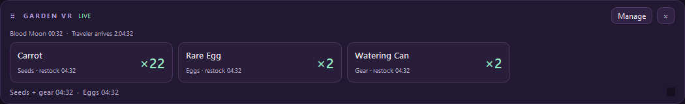
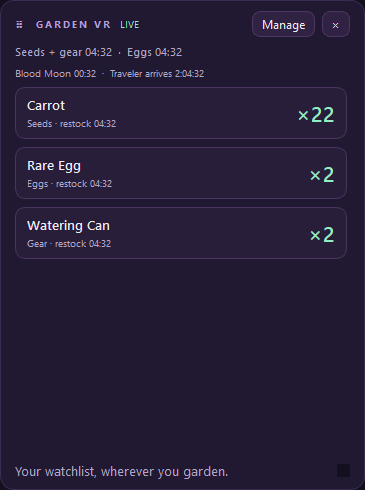

# VR capture guide

Version 1.2 adds capture-friendly windows for users of XSOverlay and similar Windows window-capture overlays. The companion still runs independently of VRChat and your browser, using the public stock API. Install and run your VR overlay software separately.

## XSOverlay setup

1. Choose your watched items in the companion.
2. Open **Preferences → VR / XSOverlay**. Enable the bar, panel, or both.
3. Leave the resulting windows open. Their titles are **Garden Companion - VR Bar** and **Garden Companion - VR Panel**.
4. In XSOverlay, enter **Layout mode**, use **Add Window**, and choose the appropriate companion window as the capture target. Use window capture, rather than capturing the whole desktop.
5. In XSOverlay's **Settings → Windows → Window Capture API**, use **Windows Graphics Capture**. Resize the source window if you want a wider bar or taller panel, then scale and position it inside VR. Adjust VR opacity in XSOverlay.
6. Save your layout in XSOverlay if desired. The companion saves each source window's visibility, size and position independently of its desktop overlays.

Official references: [XSOverlay Layout mode and Add Window](https://xsoverlay.vercel.app/gettingstarted), [window capture settings](https://xsoverlay.vercel.app/settings).





*App content rendered from a historical test response. These are Windows source-window previews, not headset captures or current stock readings. The native title bars are outside these content images.*

## Daily use

- Keep the captured window open and unminimized while using it in VR. You can hide the main watchlist window to the tray.
- The bar scrolls horizontally; the panel scrolls vertically. Resize with the normal window edges or the bottom-right grip. Use **Manage** to edit watches.
- Desktop and VR views share one watchlist and stock connection, including quantities, restock timers, weather, Traveler, bonus information and stale/offline indicators. World display can be toggled in the **World** tab.
- VR windows are opaque and stay on top of normal desktop windows. Desktop opacity preferences affect only the original desktop overlays. Control headset opacity and placement in the overlay app.
- Closing a capture window hides it without quitting the companion. Restore it from the leaf tray icon or Preferences. If a window was minimized, turning its toggle off and back on restores it.
- **Start with the main window hidden** still restores previously enabled capture windows. **Quit** ends monitoring and closes all source windows.
- Alerts remain Windows desktop notifications. This update does not send XSOverlay notification messages or directly create SteamVR overlays.

## Troubleshooting

| Symptom | What to try |
| --- | --- |
| Window not in the picker | Enable the VR capture window, confirm it is visible on the desktop, then refresh/reopen XSOverlay's window picker. Select the title containing **VR**, rather than the transparent desktop utility overlay. |
| Blank or frozen capture | Restore the source window if minimized or hidden, and reselect it in XSOverlay. Try Windows Graphics Capture first; XSOverlay also offers BitBlt as an alternative. |
| Capture lost after restarting the companion | Reselect the source window. The title stays the same, but Windows creates a new window handle on each launch; reconnect behavior depends on the overlay app. |
| Stock says STALE or OFFLINE | Check the companion's connection status. This reflects API availability, not headset tracking. Last-known quantities remain labeled until a fresh response arrives. |
| Source window off-screen | Use **Reset overlay positions** in Preferences or the tray menu. This resets desktop and VR source windows. |
| No alerts in the headset | Windows notifications are not forwarded by this integration. Watch the VR stock/world view, or use notification features supplied by your VR software. |

## Compatibility and testing limits

These are ordinary, titled Windows top-level windows with opaque backgrounds, designed to be selectable by window-capture software. No SDK, account, API key, game modification or extra companion dependency is required. Other apps that capture Windows windows may use them, but their individual capture paths have not been tested.

Automated checks cover window flags, opacity, shared stock and timers, stale state, independent visibility, minimized-window restoration, saved geometry and preference migration. Windows-native checks and packaged startup results are recorded in [VALIDATION.md](VALIDATION.md).

To repeat the offline window check from a source installation:

```powershell
.\.venv\Scripts\python.exe tools\verify_vr.py --output work\vr-check
```

This briefly opens test windows with isolated temporary preferences, saves previews and a JSON report, then exits. On native Windows it also checks that both source windows appear in top-level window enumeration, are visible and unminimized, and have no tool-window or layered-window style. It sends no network requests and does not operate XSOverlay or VRChat.

**An actual SteamVR headset / XSOverlay capture session has not been verified.** Before announcing headset compatibility as confirmed, test picking both windows, reading quantities and clocks in VR, scrolling, resizing, hiding the main window, restarting the companion and reconnecting captures on the target setup.
